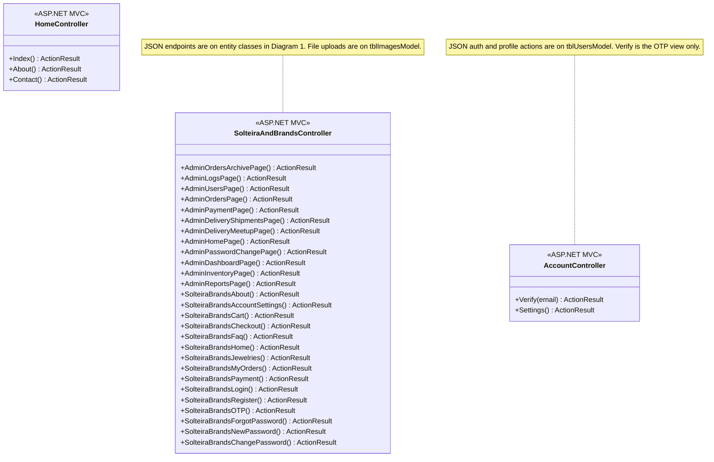

# Solteira & Brands — Class Diagram (Updated)

**Source:** `system_analysis_reference.txt`, entity classes in `Solteira&Brands/Models`, behavior in `AccountController`, `SolteiraAndBrandsController`, `OrderLifecycleRules`, `OrderDeadlineService`.

**Sibling artifacts:** [ER_Diagram_Updated.md](./ER_Diagram_Updated.md) · [Data_Dictionary_Corrected.md](./Data_Dictionary_Corrected.md)

**Legend**

- **Attributes** match `Data_Dictionary_Corrected.md` / EF models (PascalCase).
- **Methods** are the **public MVC / JSON endpoints** (and key `static` service methods) that persist or query the corresponding table. They are implemented on controllers or static classes, but are shown on the **domain entity class** in the same style as a classic UML domain diagram (compare: *Class Diagram for a Banking System*).
- **Nullable value types:** Mermaid rendering omits `?` on `DateTime` in attributes; see `Data_Dictionary_Corrected.md` for exact nullability.
- **«Controller»** classes list **page-returning** `ActionResult` members and JSON helpers that are not tied to a single entity.
- Navigation properties match EF where present; SQL-only FKs (e.g. cart → user) are shown as associations.

---

## Diagram 1 — Entity classes (attributes + methods)

```mermaid
classDiagram
  direction TB

  class tblRolesModel {
    +int Id
    +string Name
    +string Description
    +DateTime CreatedAt
  }

  class tblUsersModel {
    +int Id
    +int RoleId
    +string Email
    +string FirstName
    +string LastName
    +string Username
    +string PasswordHash
    +string PasswordSalt
    +bool IsVerified
    +bool IsActive
    +bool MustChangePassword
    +DateTime CreatedAt
    +DateTime UsernameChangedAt
    +bool AcceptedTerms
    +DateTime AcceptedAt
    +int? AvatarImageId
    +Login(username, password, rememberMe)
    +Logout()
    +Register(email username password verifyPassword acceptedTerms firstName lastName)
    +VerifyAccount(email, otp)
    +GetMyProfile()
    +UpdateProfile(avatarImageId username firstName lastName)
    +UploadProfileImage(file)
    +ForgotPassword(email)
    +ResendOtp(email, mode)
    +ValidatePasswordResetOtp(email, otp)
    +ResetPassword(email newPassword confirmPassword)
    +ChangePassword(...)
    +IsEmailAvailable(email)
    +IsUsernameAvailable(username, ignoreCurrent)
    +SeedTrialPasswords()
    +GetUsersForAdmin()
  }

  class tblVerificationTokenModel {
    +int Id
    +int UserId
    +string TokenValue
    +string TokenType
    +DateTime ExpiresAt
    +bool IsUsed
    +DateTime CreatedAt
  }

  class tblImagesModel {
    +int Id
    +string ImagePath
    +string ImageFileName
    +DateTime CreatedAt
    +DateTime UpdatedAt
    +UploadProfileImage(file)
    +UploadPaymentProof(file)
    +UploadQrImage(file)
    +UploadProductImage(file)
    +UploadMeetupProof(file)
    +UploadMeetupReceipt(file)
    +GetProductImage(imageId)
  }

  class tblProductsModel {
    +int Id
    +string Name
    +string Category
    +string Description
    +decimal Price
    +string Material
    +string Stones
    +string Weight
    +string Length
    +int StockQuantity
    +int? InitialStock
    +int? ImageId
    +bool IsBestSeller
    +bool IsFeatured
    +bool IsArchived
    +DateTime CreatedAt
    +DateTime UpdatedAt
    +GetInventoryProducts(archived)
    +GetLowStockNotifications()
    +CreateProduct(ProductSaveRequest)
    +UpdateProduct(ProductSaveRequest)
    +ToggleProductArchive(id)
    +ToggleFeatured(productId)
    +GetStorefrontProducts()
    +GetProductStock(productId)
    +GetProductStocks(productIds)
  }

  class tblCartsModel {
    +int Id
    +int UserId
    +bool IsActive
    +DateTime CreatedAt
    +DateTime UpdatedAt
    +GetCartCount()
    +GetMyCart()
    +AddToCart(productId, quantity)
    +SetCartItemQuantity(productId, quantity)
    +RemoveCartItem(productId)
  }

  class tblCartItemsModel {
    +int Id
    +int CartId
    +int ProductId
    +int Quantity
    +DateTime CreatedAt
    +DateTime UpdatedAt
  }

  class tblOrdersModel {
    +int Id
    +int UserId
    +string OrderNumber
    +string CustomerName
    +string ContactNumber
    +string DeliveryAddress
    +string PaymentMethod
    +string PaymentType
    +decimal TotalAmount
    +decimal RemainingBalance
    +string OrderStatus
    +DateTime PaymentDeadline
    +DateTime PaymentDeadlineReminderSentFor
    +DateTime PaymentDeadlineReminderSentAt
    +string CancellationReason
    +bool InventoryReleased
    +bool IsLayaway
    +string DeliveryType
    +DateTime MeetupDatetime
    +string RejectionReason
    +DateTime CreatedAt
    +DateTime LastStatusUpdateAt
    +bool IsArchived
    +CreateOrder()
    +GetOrders()
    +GetOrderDetails(id)
    +GetMyOrders()
    +GetOrderForPayment(orderId)
    +UpdateOrderStatus(id, status, rejectionReason, restoreStock)
    +RevokeApproval(orderId)
    +ArchiveOrder(orderId)
    +RestoreOrder(orderId)
    +GetArchiveOrders()
    +GetDashboardData(range, startDate, endDate)
    +GetSalesReport(range, startDate, endDate, category)
    +PostSalesReport(range, startDate, endDate, category)
    +CheckAndCancelOverdueOrders()
    +GetOrdersForDeliveryShipments()
    +GetOrdersForDeliveryMeetup()
    +GetMeetupOrderDetail(orderId)
    +MarkReadyForMeetup(orderId)
    +CompleteMeetup(orderId)
    +RescheduleMeetup(orderId meetupDate meetupTime)
  }

  class tblOrderItemsModel {
    +int Id
    +int OrderId
    +int? ProductId
    +string ProductName
    +int Quantity
    +decimal UnitPrice
    +string ImageUrl
  }

  class tblPaymentsModel {
    +int Id
    +int OrderId
    +decimal Amount
    +string PaymentStatus
    +string RejectionReason
    +int? ProofImageId
    +string ReferenceNumber
    +DateTime MeetupDatetime
    +string PaymentChannel
    +int? VerifiedByUserId
    +DateTime CreatedAt
    +DateTime VerifiedAt
    +int AllowResubmit
    +SubmitPayment(SubmitPaymentRequest)
    +UpdatePaymentStatus(paymentId, status, rejectionReason, allowResubmit)
    +GetPaymentsForAdmin()
    +GetPaymentDetailForAdmin(paymentId)
    +GetPaymentSettings()
  }

  class tblDeliveriesModel {
    +int Id
    +int OrderId
    +string DeliveryType
    +string Courier
    +DateTime DispatchDate
    +DateTime Eta
    +string TrackingNumber
    +string TrackingLink
    +DateTime MeetupDatetime
    +string DeliveryStatus
    +DateTime CreatedAt
    +DateTime UpdatedAt
    +CreateDelivery(orderId deliveryType trackingNumber courier dispatchDate eta)
    +UpdateDeliveryStatus(deliveryId, status)
    +UpdateDelivery(deliveryId courier trackingNumber dispatchDate eta deliveryStatus)
    +GetDeliveryShipments()
    +GetDeliveryDetailForAdmin(deliveryId)
  }

  class tblMeetupOutcomeModel {
    +int Id
    +int OrderId
    +string Status
    +int? ReceiptImageId
    +DateTime CreatedAt
    +UpdateMeetupOutcome(orderId status receiptImageId proofImageId cancellationReason restoreStock)
  }

  class tblPaymentSettingsModel {
    +int Id
    +string PaymentType
    +string AccountName
    +string AccountNumber
    +int? QrImageId
    +bool IsActive
    +DateTime CreatedAt
    +DateTime UpdatedAt
    +GetPaymentSettingsForAdmin()
    +UpdatePaymentSetting(paymentType, accountName, accountNumber, qrImageId)
  }

  class tblMeetupSettingsModel {
    +int Id
    +string LocationName
    +string Address
    +bool IsActive
    +DateTime CreatedAt
    +GetMeetupSettings()
    +GetMeetupSettingsForAdmin()
    +UpdateMeetupSetting(locationName, address)
  }

  class tblLayawaySettingsModel {
    +int Id
    +decimal DownpaymentPercentage
    +int MonthsAllowed
    +int? ResubmitWindowDays
    +int? GracePeriodDays
    +DateTime CreatedAt
    +GetLayawaySettings()
    +GetLayawaySettingsForAdmin()
    +UpdateLayawaySettings(downpaymentPercentage, monthsAllowed, resubmitWindowDays, gracePeriodDays)
  }

  class tblActivityLogModel {
    +int Id
    +int UserId
    +string Username
    +string RoleName
    +string Action
    +string Module
    +int? EntityId
    +string Details
    +DateTime CreatedAt
    +GetActivityLogs()
  }

  class OrderLifecycleRules {
    <<static>>
    +CanTransitionOrder(from, to) bool
    +CanTransitionPayment(from, to) bool
    +CanTransitionDelivery(from, to) bool
    +IsPaymentPendingReview(status) bool
  }

  class OrderDeadlineService {
    <<static>>
    +StartAutoCancellationJob()
    +EnforcePaymentDeadlines() int
    +CancelOrder(orderId, reason) bool
  }

  tblRolesModel "1" --> "*" tblUsersModel : Role
  tblUsersModel "*" --> "0..1" tblImagesModel : AvatarImage
  tblUsersModel "1" --> "*" tblVerificationTokenModel
  tblUsersModel "1" --> "*" tblOrdersModel
  tblUsersModel "1" --> "*" tblCartsModel
  tblUsersModel "1" --> "*" tblActivityLogModel
  tblPaymentsModel "*" --> "0..1" tblUsersModel : VerifiedByUser

  tblCartsModel "1" --> "*" tblCartItemsModel
  tblProductsModel "1" --> "*" tblCartItemsModel
  tblProductsModel "1" --> "*" tblOrderItemsModel

  tblOrdersModel "1" --> "*" tblOrderItemsModel
  tblOrdersModel "1" --> "*" tblPaymentsModel
  tblOrdersModel "1" --> "*" tblDeliveriesModel
  tblOrdersModel "1" --> "*" tblMeetupOutcomeModel

  tblPaymentsModel "*" --> "0..1" tblImagesModel : ProofImage
  tblMeetupOutcomeModel "*" --> "0..1" tblImagesModel : ReceiptImage
  tblPaymentSettingsModel "*" --> "0..1" tblImagesModel : QrImage

  OrderLifecycleRules ..> tblOrdersModel : validates
  OrderLifecycleRules ..> tblPaymentsModel : validates
  OrderLifecycleRules ..> tblDeliveriesModel : validates
  OrderDeadlineService ..> tblOrdersModel : deadlines

  note for tblRolesModel "Seeded; no dedicated CRUD API."
  note for tblVerificationTokenModel "Rows created/consumed by Register, VerifyAccount, password reset."
  note for tblCartItemsModel "Mutated via cart JSON endpoints on tblCartsModel."
  note for tblOrderItemsModel "Inserted when CreateOrder runs."
  note for tblMeetupOutcomeModel "READY_FOR_MEETUP may be inserted from payment verification."
```

---

## Diagram 2 — MVC controllers (pages + shared UI)

---

## Consistency with ER diagram and data dictionary

| Concept | ER diagram | Data dictionary | Class diagram |
|---------|------------|-----------------|---------------|
| Table / entity names | `tbl_*` blocks | `tbl_*` sections | `tbl*Model` classes |
| Columns | Listed in ERD attributes | Full typing + keys | Property list on class |
| Category dimension | No entity | `tbl_products.category` string | `Category` on `tblProductsModel` |
| Cart FKs | Drawn | Documented | `tblCartsModel` → `tblCartItemsModel`, user_id |
| Meetup outcomes | 1:M from order | `tbl_meetup_outcomes` | `tblMeetupOutcomeModel` `*` from order |
| `auth_provider` | Not in ERD entity attrs | DB-only footnote on users | Not on `tblUsersModel` |

---

## Implementation note (cart after checkout)

`CreateOrder()` does **not** remove `tbl_cart_items` in the controller; documentation and product behavior should agree (see `system_analysis_reference.txt`).
