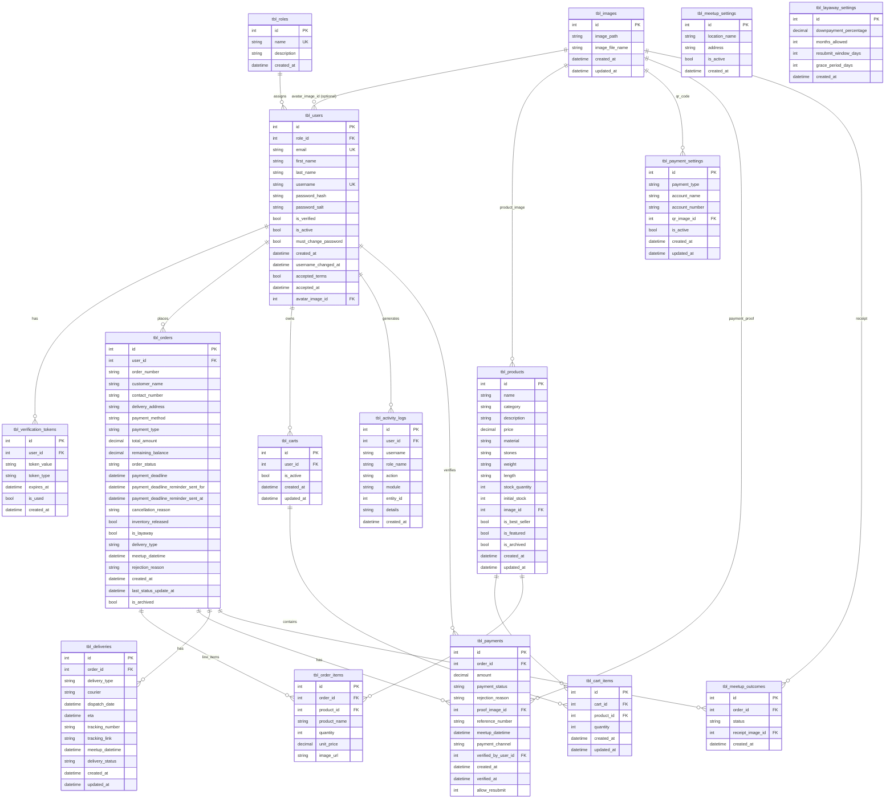

# Solteira & Brands — ER Diagram (Updated)

**Source:** `system_analysis_reference.txt` (current schema: EF6 + MySQL `CreateTables_And_Seed.sql`).  
**Consistency:** Table and column names match `Data_Dictionary_Corrected.md` and entity attributes in `Class_Diagram_Updated.md`.

**Sibling artifacts:** [Data_Dictionary_Corrected.md](./Data_Dictionary_Corrected.md) · [Class_Diagram_Updated.md](./Class_Diagram_Updated.md)

**Notes**

- There is **no** `tbl_categories` entity; product category is the string column `tbl_products.category`.
- `tbl_users.auth_provider` exists in the database script but is **not** mapped in EF; it appears only in the data dictionary footnote.
- `tbl_meetup_outcomes` is **1:M** per order (history of outcomes), not 1:1.

## Diagram (Mermaid)

## Relationship summary (cardinality)

| Parent | Child | Cardinality | FK column(s) |
|--------|--------|-------------|--------------|
| tbl_roles | tbl_users | 1 : M | user.role_id |
| tbl_users | tbl_verification_tokens | 1 : M | user_id |
| tbl_users | tbl_orders | 1 : M | user_id |
| tbl_users | tbl_carts | 1 : M | user_id |
| tbl_users | tbl_activity_logs | 1 : M | user_id |
| tbl_users | tbl_payments (as verifier) | 1 : M | verified_by_user_id (optional) |
| tbl_images | tbl_users (avatar) | 1 : M | avatar_image_id (optional) |
| tbl_images | tbl_products | 1 : M | image_id (optional) |
| tbl_images | tbl_payment_settings | 1 : M | qr_image_id (optional) |
| tbl_images | tbl_payments | 1 : M | proof_image_id (optional) |
| tbl_images | tbl_meetup_outcomes | 1 : M | receipt_image_id (optional) |
| tbl_carts | tbl_cart_items | 1 : M | cart_id |
| tbl_products | tbl_cart_items | 1 : M | product_id |
| tbl_orders | tbl_order_items | 1 : M | order_id |
| tbl_products | tbl_order_items | 1 : M (optional) | product_id (nullable) |
| tbl_orders | tbl_payments | 1 : M | order_id |
| tbl_orders | tbl_deliveries | 1 : M | order_id |
| tbl_orders | tbl_meetup_outcomes | 1 : M | order_id |

`tbl_meetup_settings` and `tbl_layaway_settings` are **standalone configuration** tables (no FKs to orders).
